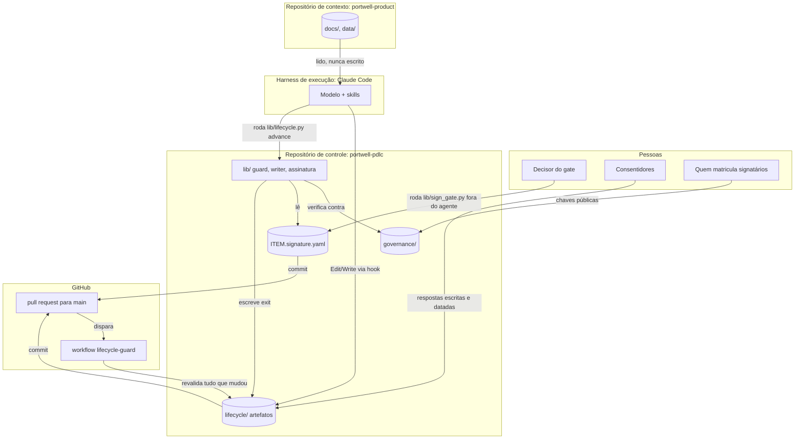
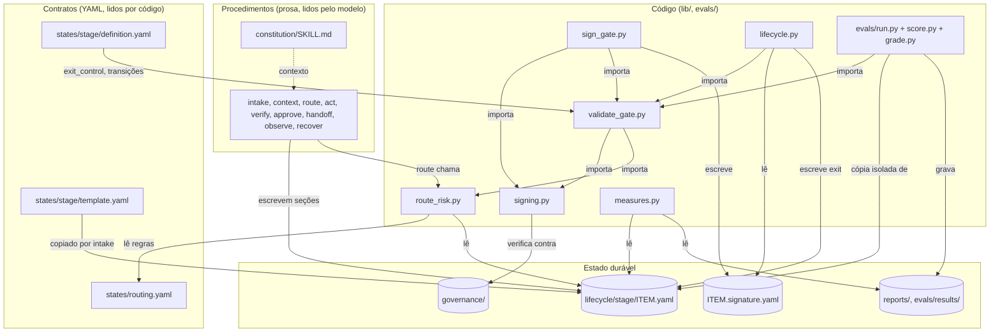
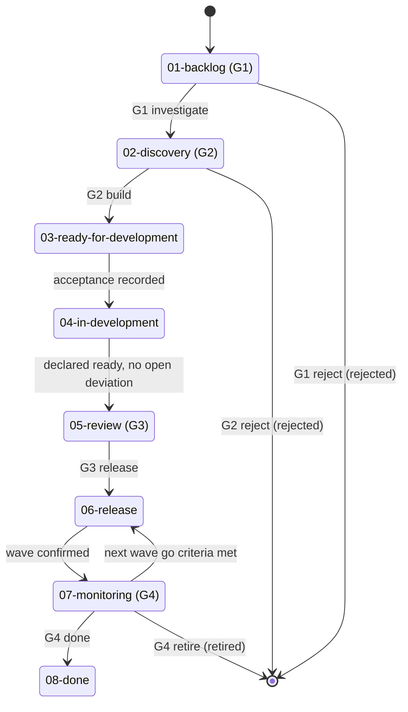
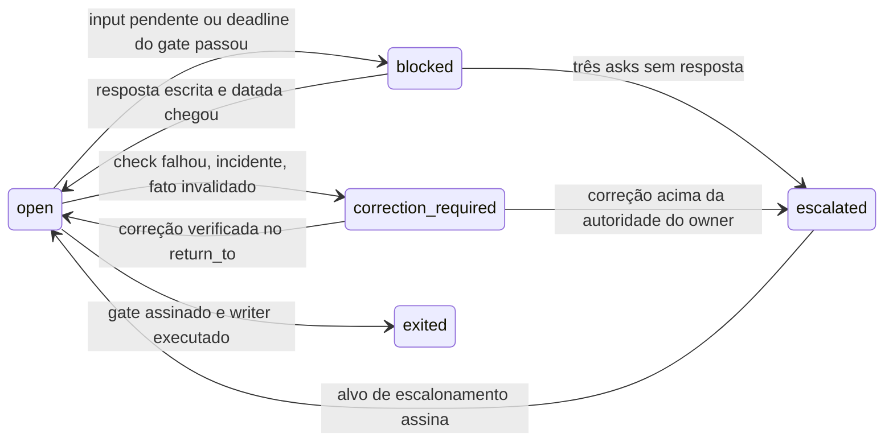
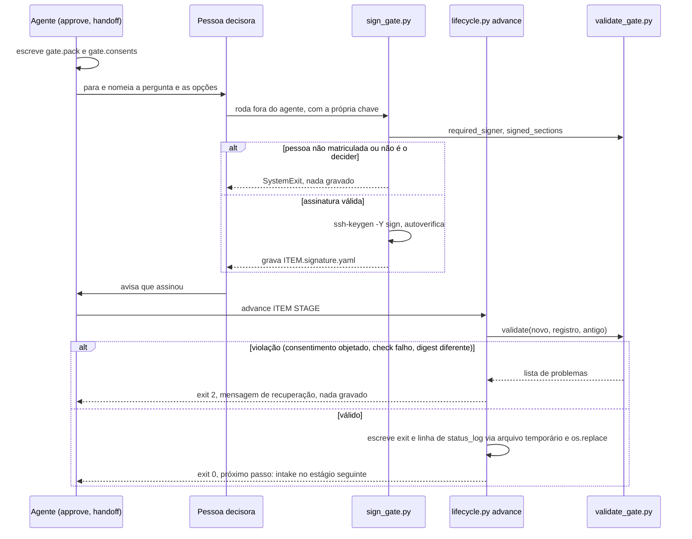
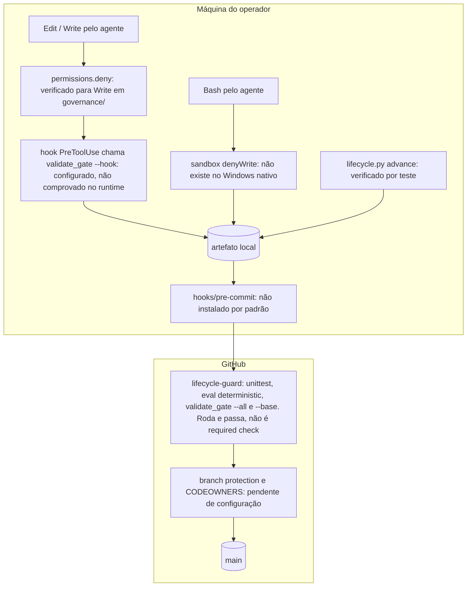
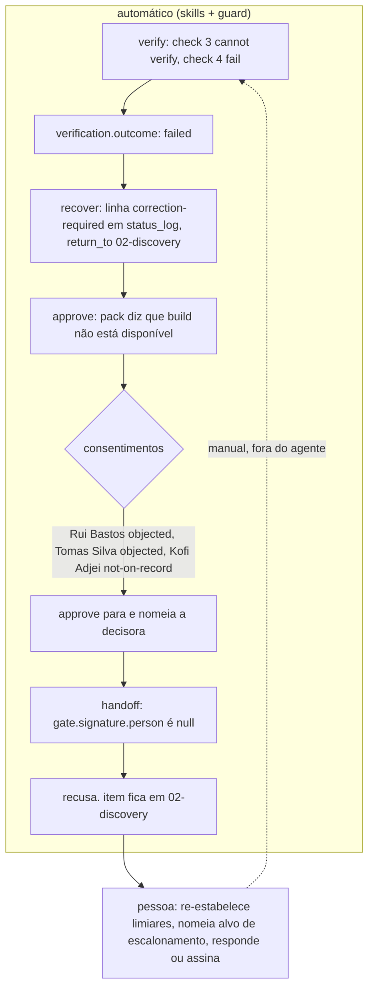

# Portwell PDLC harness

Um harness agêntico para o Product Development Lifecycle (PDLC) da Portwell Software, construído
ao longo dos Módulos 1 a 4 do curso de Advanced SDLC and harness engineering da Indicium. A unidade
de trabalho é **uma decisão de produto**: uma oportunidade com ID estável que atravessa oito
estágios e quatro gates, carregando a evidência que cada decisão usou.

A pergunta que o sistema procura responder:

> Quais evidências permitem avançar uma decisão de piloto e quais condições exigem reavaliá-la?

O repositório contém o contrato do lifecycle, os procedimentos que o modelo segue, um guard
determinístico, assinaturas SSH como prova de decisão humana, um eval harness protegido e um
relatório operacional. Ele lê o repositório `portwell-product` como fonte de contexto e nunca o
escreve.

Estado documentado: branch `main`, commit `90e5325`, 2026-10-29. Onde este texto diz "verificado",
a verificação foi feita nessa data, nesse commit, por execução ou teste.

## Índice

1. [Como ler este documento](#1-como-ler-este-documento)
2. [Visão geral da arquitetura](#2-visão-geral-da-arquitetura)
3. [Dois níveis de lifecycle](#3-dois-níveis-de-lifecycle)
4. [Fluxo ponta a ponta: OPPORTUNITY-04](#4-fluxo-ponta-a-ponta-opportunity-04)
5. [Modelo de dados e artefatos](#5-modelo-de-dados-e-artefatos)
6. [Controles e fronteiras de confiança](#6-controles-e-fronteiras-de-confiança)
7. [Falhas, recuperação e limites](#7-falhas-recuperação-e-limites)
8. [Testes, avaliações e métricas](#8-testes-avaliações-e-métricas)
9. [Instalação e operação](#9-instalação-e-operação)
10. [Estrutura do repositório](#10-estrutura-do-repositório)
11. [Limitações e evolução](#11-limitações-e-evolução)

## 1. Como ler este documento

**Vocabulário usado ao longo do texto.**

| Termo | Significado aqui |
| :- | :- |
| Item | Uma oportunidade com ID emitido pelo repositório de produto (por exemplo `OPPORTUNITY-04`) e um tipo (`poc`, `pilot`, `mvp`, `feature`, `new-product`, `deprecation`) |
| Estágio | Uma das oito colunas do lifecycle de domínio, de `01-backlog` a `08-done`. Cada estágio tem uma pasta em `lifecycle/` e um contrato em `states/` |
| Gate | Um bloco de decisão assinado que fecha um estágio: G1 triagem, G2 decisão de produto, G3 decisão de release, G4 revisão de resultado |
| Status | Uma tag na condição do item dentro do estágio: `open`, `blocked`, `escalated`, `correction-required`, `exited`, `rejected`, `retired` |
| Artefato | O único arquivo YAML que um item tem por estágio: `lifecycle/<stage>/<ITEM>.yaml` |
| Skill | Um procedimento em prosa, em `skills/<nome>/SKILL.md`, que o modelo segue dentro de um estágio |
| Guard | O validador determinístico `lib/validate_gate.py`, que decide se uma escrita em um artefato é aceitável |
| Registro assinado | O arquivo `lifecycle/<stage>/<ITEM>.signature.yaml`, produzido por uma pessoa com a própria chave SSH |

**Caminhos de leitura.**

- Para entender a arquitetura em quinze minutos: seções 2, 3 e 6, mais os diagramas 1, 3 e 5.
- Para operar o sistema: seções 9 e 7, depois a seção 4 como exemplo.
- Para contribuir com código: seções 5, 6, 8 e 11.

**Categorias usadas nas afirmações sobre controles.**

| Categoria | Significa |
| :- | :- |
| Implementado | Existe no código ou na configuração |
| Verificado | Há evidência de teste ou execução, com o escopo indicado |
| Pendente de configuração | Depende de uma ativação operacional que ainda não foi feita |
| Proposto | Mudança ainda não implementada |
| Não verificado | Não foi possível comprovar |

## 2. Visão geral da arquitetura

### 2.1 Responsabilidades

O sistema é a soma de quatro camadas, mais as pessoas e o GitHub ao redor.

- **Modelo.** Lê a constituição e a skill do passo atual, interpreta o contexto e propõe escritas no
  artefato. Nada que o modelo escreve conta como decisão.
- **Harness de execução.** Claude Code, herdado. Fornece o loop, as ferramentas `Read`, `Edit`,
  `Write` e `Bash`, as permissões, o hook `PreToolUse` e, no Linux e macOS, o sandbox. O repositório
  só o configura, em [`.claude/settings.json`](.claude/settings.json).
- **Camada organizacional de controle.** O que o grupo construiu: contratos em
  [`states/`](states/), procedimentos em [`skills/`](skills/), guard, assinatura, writer de
  transição, roteamento de risco, eval e medidas em [`lib/`](lib/) e [`evals/`](evals/), âncora de
  confiança em [`governance/`](governance/).
- **Estado durável e evidências.** Os artefatos em [`lifecycle/`](lifecycle/), os registros
  assinados ao lado deles, [`board.md`](board.md) e [`traces/`](traces/).
- **Ambiente externo.** O repositório `portwell-product`, apontado por
  [`track.yaml`](track.yaml) e lido como evidência, nunca escrito.
- **Pessoas.** O decisor de cada gate (hoje sempre a product lead), os consentidores derivados das
  políticas que o item aciona, e quem matricula signatários em `governance/`.
- **GitHub e CI.** O workflow [`lifecycle-guard`](.github/workflows/guard.yml) executa os testes, o
  self-test do eval e o guard sobre tudo que mudou. [`CODEOWNERS`](.github/CODEOWNERS) nomeia quem
  deve revisar os caminhos que decidem no que o guard confia.

**O que é herdado e o que é implementado.**

| Herdado do runtime | Configurado pelo projeto | Implementado pelo grupo |
| :- | :- | :- |
| Loop do agente, integração com o modelo, ferramentas de arquivo e shell, janela de contexto, modos de permissão | `permissions.deny`, `sandbox.filesystem.denyWrite`, hook `PreToolUse`, ferramentas permitidas nas sessões de eval | Contratos, skills, guard, assinatura, writer, roteamento, eval, medidas, CI, governança |

### 2.2 Diagrama 1. Contexto e fronteiras

**Pergunta:** quem interage com o sistema e onde estão seus limites?



O modelo nunca toca `governance/` nem os registros assinados. O decisor nunca roda a assinatura
dentro da sessão do agente. O repositório de contexto só entra como leitura. O GitHub revalida o
que chegou por qualquer caminho, o que importa porque uma escrita pelo shell não passa pelo hook.

### 2.3 Tabela de componentes

| Componente | Responsabilidade | Entrada | Saída | Implementação |
| :- | :- | :- | :- | :- |
| Constituição | Regras que nenhuma skill pode quebrar (oito artigos, condições de parada) | Lida pelo modelo em toda sessão via `CLAUDE.md` | Comportamento do modelo | [`skills/constitution/SKILL.md`](skills/constitution/SKILL.md), prosa |
| Nove skills | Procedimento de cada passo dentro de um estágio | `item`, `stage`, o contrato do estágio, o artefato | Seções do artefato | [`skills/*/SKILL.md`](skills/), prosa |
| Contratos de estágio | Entrada, evidência, saída, owner, transições, caminho de falha, `exit_control` | Editados por pessoas quando o processo muda | Lidos pelo guard e pelas skills | [`states/<stage>/definition.yaml`](states/), YAML |
| Templates e schema | Esqueleto de cada artefato e header comum | Copiados por intake | Artefato novo | [`states/<stage>/template.yaml`](states/), [`states/schema.yaml`](states/schema.yaml) |
| Statuses e tipos | Os sete status e os seis tipos de item, com o que cada gate exige | Lidos por skills | Regras de prosa | [`states/statuses.yaml`](states/statuses.yaml), [`states/types.yaml`](states/types.yaml) |
| Roteamento de risco | Decide `fast` ou `full` por regra, sem julgamento do modelo | Artefato e gate | JSON com caminho e regras disparadas | [`lib/route_risk.py`](lib/route_risk.py) sobre [`states/routing.yaml`](states/routing.yaml) |
| Guard | Recusa escritas que violem assinatura, consentimentos, `exit_checks`, append-only | Artefato proposto, versão anterior, registro assinado | Exit 0 ou 2 com mensagem de recuperação | [`lib/validate_gate.py`](lib/validate_gate.py) |
| Assinatura | Prova criptográfica de que uma pessoa decidiu | Item, estágio, outcome, statement, chave privada da pessoa | `lifecycle/<stage>/<ITEM>.signature.yaml` | [`lib/sign_gate.py`](lib/sign_gate.py), [`lib/signing.py`](lib/signing.py), `ssh-keygen -Y` |
| Writer de transição | Único caminho sancionado para escrever `exited` e `exited_to` | Artefato e registro assinado | Artefato com exit e nova linha de `status_log` | [`lib/lifecycle.py`](lib/lifecycle.py) |
| Governança | Quem pode assinar e com qual chave | Pessoa matricula | Allowlist lida pelo guard | [`governance/signers.yaml`](governance/signers.yaml), [`governance/allowed_signers`](governance/allowed_signers) |
| Eval harness | Mede se as skills obedecem à constituição em casos normais e adversariais | Casos em `evals/cases/`, sessões em cópia isolada | Resultados em `evals/results/`, baseline | [`evals/run.py`](evals/run.py), [`evals/score.py`](evals/score.py), [`evals/grade.py`](evals/grade.py) |
| Medidas | Relatório operacional a partir do eval e do registro do lifecycle | `evals/results/*.jsonl`, `lifecycle/`, `evals/human-grades.yaml` | [`reports/operating-report.md`](reports/operating-report.md) | [`lib/measures.py`](lib/measures.py) |
| CI | Revalida tudo que mudou desde a base do PR | Push ou PR | Status do check | [`.github/workflows/guard.yml`](.github/workflows/guard.yml) |
| Hook local | Intercepta `Write`, `Edit`, `MultiEdit`, `NotebookEdit` e chama o guard | Payload JSON da ferramenta | Exit 0 ou 2 | [`.claude/settings.json`](.claude/settings.json) |
| Pre-commit | Mesmo check do CI antes do commit local | `git commit` | Exit 0 ou 2 | [`hooks/pre-commit`](hooks/pre-commit), precisa ser instalado |

### 2.4 Diagrama 2. Componentes internos

**Pergunta:** como os componentes implementam o fluxo?



Setas sólidas são dependência de código ou fluxo de dados, rotuladas com o verbo. A seta pontilhada
é contexto carregado no modelo. A dependência entre módulos de `lib/` é uma árvore sem ciclos:
`signing` na base, `route_risk` ao lado, `validate_gate` sobre os dois, `sign_gate` e `lifecycle`
sobre o guard, e `evals/` sobre todos.

## 3. Dois níveis de lifecycle

O repositório tem dois lifecycles que é fácil confundir.

**O lifecycle de domínio** é o caminho da decisão de produto. São os oito estágios definidos em
`states/`, com quatro gates entre eles. É o que fica persistido: um artefato por item por estágio.

**O loop de execução do agente** são as nove skills: Intake, Context, Route, Act, Verify, Approve,
Handoff, Observe e Recover. Elas rodam **dentro** de um estágio, na ordem que o
`skills_sequence` do contrato do estágio determina. Não são estados do produto e não ficam
persistidas como tal. Em `02-discovery`, por exemplo, a sequência é intake, context, route, act,
verify, approve, handoff; em `03-ready-for-development` é só intake e handoff. A tabela completa
está em [`skills/README.md`](skills/README.md).

Quatro coisas distintas que o artefato registra:

| Conceito | Campo | Quem escreve | Exemplo |
| :- | :- | :- | :- |
| Estágio do item | `stage` e a pasta do arquivo | intake, ao criar o artefato | `02-discovery` |
| Status operacional | `status`, `status_since`, `status_log[]` | recover (à mão hoje) e `lifecycle.py advance` para `exited` | `escalated` desde 2026-08-12 |
| Outcome de um gate | `gate.outcome`, espelho do registro assinado | só `lifecycle.py advance`, a partir da assinatura | `build`, `reject`, `more-discovery`, `defer` |
| Transição de estágio | `exited`, `exited_to` | só `lifecycle.py advance` | `exited_to: 03-ready-for-development` |

Um item pode mudar de status várias vezes sem mudar de estágio. Um outcome que mantém o item no
estágio (`more-discovery`, `defer`, `park`) é uma mudança de status, não uma transição, e o writer
recusa tratá-lo como exit. A precedência quando há mais de um episódio aberto é `escalated`,
`blocked`, `correction-required`, `open`, definida em `states/statuses.yaml`.

### Diagrama 3. Lifecycle de domínio, caminho principal

**Pergunta:** por quais estágios uma decisão pode passar?



Transições derivadas de `allowed_transitions` em cada `states/<stage>/definition.yaml`. Os gates
estão nos estágios 01, 02, 05 e 07. Os estágios 03 e 04 são "emprestados" da engenharia: o produto
registra a dependência e não executa o trabalho. O laço 07 para 06 é a liberação por ondas. G4
`iterate` cria um novo item em `01-backlog` com `links.spawned_by`, e exige um ID emitido pelo
repositório de produto, por isso não aparece como seta.

**Caminhos de exceção.** Os status abaixo acontecem dentro de um estágio, sem mudar de pasta.



Definições em [`states/statuses.yaml`](states/statuses.yaml). `escalated` tem um caminho de
falha próprio: quando não existe alvo nomeado, o item fica escalado e o artefato registra sob
`unknowns` que o processo não tem a quem escalar. É o estado real de `OPPORTUNITY-04`.

## 4. Fluxo ponta a ponta: OPPORTUNITY-04

O único item traçado até hoje é `OPPORTUNITY-04`, a expansão do piloto do portal de ajuda. O
registro completo está em [`traces/worked-case.md`](traces/worked-case.md). Os passos 1 a 6 abaixo
foram observados na execução de 2026-09-24; os passos 7 a 10 são a continuação **ilustrativa**,
como o código a executaria. Nenhum gate foi assinado e nenhuma transição aconteceu.

### Trecho observado

1. **Abertura.** `intake` criou `lifecycle/01-backlog/OPPORTUNITY-04.yaml` retroativamente, a partir
   do brief de 2026-06-18, da linha do tracker e dos quatro pedidos de stakeholders. Não existe
   registro de G1. Pela regra de onboarding legado em
   [`skills/intake/SKILL.md`](skills/intake/SKILL.md), o artefato de `02-discovery` também foi
   criado, com `entry_ticket.g1_signed_on: unknown` e a primeira linha de `status_log` dizendo
   "entered without gate record". O item aparece em duas colunas do
   [`board.md`](board.md), e isso é um achado, não um erro.
2. **Contexto.** `context` leu 22 documentos listados em `sources` e produziu 27 fatos em
   `evidence_manifest`, cada um com caminho, autor, data e versão da métrica ou `unknown`. O passe
   de validade marcou os números do brief como invalidados pelo INCIDENT-01. Oito contradições
   ficaram registradas com as duas versões e `resolved_by: null`. Doze unknowns nomeiam quem pode
   respondê-los.
3. **Risco e rota.** `route` propôs `type: feature`, listou quatro políticas acionadas com seus
   owners, escreveu sete checks determinísticos com entrada e resultado (28 contas contra o limite
   25 de POLICY-08: `exceeds`), derivou os signatários de G2 e G3 e propôs duas ondas. O comando
   `python lib/route_risk.py lifecycle/02-discovery/OPPORTUNITY-04.yaml --gate G2` devolve `full`
   com seis regras disparadas, quatro delas por `unknown`.
4. **Artefatos.** `act` escreveu `decision_draft` na forma do DECISION-0031, com cada frase da
   justificativa terminando nos IDs do manifesto que a sustentam, e `review_date: unknown`.
5. **Verificação.** `verify` copiou os sete checks de
   [`states/02-discovery/definition.yaml`](states/02-discovery/definition.yaml), escreveu
   `looked_at` e resultado para cada um: cinco `pass`, um `cannot verify` (os limiares registrados
   do EXPERIMENT-02 são desconhecidos), um `fail` (POLICY-10 citado após supersessão).
   `verification.outcome: failed`. `recover` abriu as linhas 2 a 5 de `status_log`: bloqueado em
   POLICY-03 desde 2026-07-11, escalado sem alvo desde 2026-08-12, bloqueado pelo deadline de G2
   vencido, correção requerida pela verificação.
6. **Consentimentos e pack.** `approve` registrou três consentimentos em `gate.consents`: Rui
   Bastos `objected` com a frase de 2026-08-08, Tomas Silva `objected` para LATAM com a frase de
   2026-08-11, Kofi Adjei `not-on-record`. O `gate.pack` abre dizendo que `build` não está
   disponível, lista o conhecido, o desconhecido e as contradições que dependem de G2, e
   `recommendation: null`. `handoff` recusou mover o item: `gate.signature.person` é nulo.

### Continuação ilustrativa

7. **Assinatura.** Se Ana Fialho decidisse, ela rodaria em um terminal próprio, fora do agente:

   ```text
   python lib/sign_gate.py OPPORTUNITY-04 02-discovery --person "Ana Fialho" --statement "<as palavras dela>" --outcome more-discovery
   ```

   `sign_gate.py` exige que ela esteja em `governance/signers.yaml` (hoje ninguém está), confere
   que a definição do estágio a nomeia como `decider`, mostra o registro, pede confirmação no
   terminal, assina com `ssh-keygen -Y sign` e grava `OPPORTUNITY-04.signature.yaml`, que é
   imutável depois de commitado.
8. **Transição.** Para um outcome que move o item, `handoff` rodaria
   `python lib/lifecycle.py advance OPPORTUNITY-04 02-discovery`. O writer lê o registro assinado,
   resolve a transição em `allowed_transitions`, prepara o texto com `exited`, `exited_to`,
   `status: exited`, `gate.outcome` e uma linha nova de `status_log`, roda o guard sobre o resultado
   e só grava se ele devolver zero. Para `more-discovery`, que mantém o item em discovery, o writer
   recusa (`cannot be exited`) e o status muda à mão por `recover`.
9. **CI.** O commit chega a um PR. `guard.yml` roda os testes, o self-test do eval,
   `validate_gate.py --all` e `validate_gate.py --base <merge-base>`, que revalida o artefato contra
   a versão base, exige que o registro assinado só tenha sido adicionado e verifica a assinatura.
10. **Reavaliação.** Em `07-monitoring`, `observe` ligaria incidentes de `docs/incidents/` aos fatos
    datados antes deles e dispararia `correction-required`. Hoje isso existe só em prosa, em
    [`skills/observe/SKILL.md`](skills/observe/SKILL.md) e
    [`skills/recover/SKILL.md`](skills/recover/SKILL.md).

### Diagrama 4. Sequência de assinatura e avanço

**Pergunta:** o que acontece entre preparar uma decisão e persistir sua saída?



O agente nunca chama `sign_gate.py`; a skill `handoff` diz isso explicitamente, e o guard não tem
como distinguir quem rodou o comando. O que impede o agente de assinar é não ter a chave privada
na máquina e a confirmação interativa do terminal, que a flag `--yes` pula (ver seção 11).

## 5. Modelo de dados e artefatos

Todo artefato começa pelo header de [`states/schema.yaml`](states/schema.yaml) e segue com as
seções do template do estágio. As regras abaixo valem para todos.

### 5.1 Blocos e quem os escreve

| Bloco | Conteúdo | Quem escreve | Proteção por código |
| :- | :- | :- | :- |
| Header: `item`, `type`, `stage`, `owner`, `entered`, `entered_from`, `links`, `refs` | Identidade do item no estágio | intake | `item`, `stage`, `entered`, `entered_from` não podem mudar depois de criados (guard, append-only) |
| `status`, `status_since` | Status operacional atual | recover (à mão), `advance` para `exited` | Mudar sem linha nova em `status_log` é recusado; mudar para `exited` por Edit é recusado |
| `exited`, `exited_to` | Transição | só `lifecycle.py advance` | Edit direto recusado pelo hook; exit sem registro assinado recusado pelo guard |
| `sources[]` | Cada documento lido: `path`, `author`, `dated`, `revised`, `note` | intake, context | Entradas existentes não podem ser alteradas ou removidas |
| `evidence_manifest[]` | Um fato por entrada: `id`, `fact`, `value`, `source`, `metric_version`, `verbal`, `invalidated_by`, `validity`, `reaffirmed_by` | context | Nenhuma. `reaffirmed_by` é de autoria humana por regra de prosa |
| `unknowns[]` | `fact`, `needed_for`, `asked_to`, `asked_on` | context, intake | Nenhuma. Contados por `route_risk` quando `needed_for` nomeia o gate |
| `contradictions[]` | `fact`, `a`, `b`, `depends`, `resolved_by` | context | Nenhuma. `resolved_by` é de autoria humana por regra de prosa. Contadas por `route_risk` enquanto `resolved_by` é nulo |
| `controls_missing[]` | Checks feitos à mão que um módulo posterior torna executáveis | verify | Nenhuma |
| `status_log[]` | Uma linha por mudança de status: `n`, `status`, `since`, `until`, `reason`, `waiting_on`, `owner`, `asks`, `limit`, `escalate_to`, `return_to` | recover, `advance` | Linhas existentes não podem ser reescritas; só `until` pode ser preenchido uma vez |
| `route_note` | `type_proposed`, `policies_triggered`, `deterministic_checks`, `signatories_g2`, `signatories_g3`, `waves_proposed`, `risk_inputs`, `path` | route | `risk_inputs` é lido por `route_risk`; o valor declarado não é conferido contra a fonte |
| `decision_draft` | `reference`, `decision`, `rationale`, `scope`, `out_of_scope`, `evidence`, `constraints`, `review_date`, `type` | act | `review_date` presente é exigido no caminho `full` (02-discovery). O conteúdo não é coberto pela assinatura |
| `verification` | `performed_on`, `checks[]` com `check`, `looked_at`, `result`, `note`, e `outcome` | verify | `outcome == passed` é exigido para avançar. A coerência entre `checks[].result` e `outcome` não é conferida |
| `gate.consents[]` | `person`, `role`, `because`, `response`, `responded_on`, `state` | approve | `state: consented` exige `response` e `responded_on` não vazios. Autoria não é conferida. Todo consentimento deve estar `consented` para avançar |
| `gate.pack` | `summary`, `known`, `unknown`, `contradictions`, `recommendation` | approve | Faz parte do digest assinado. `recommendation` fica nulo por regra de prosa |
| `gate.evidence_review` | `reviewed_on`, `reviewer`, `criteria`, `findings`, `verdict` | approve, a partir de um revisor separado | `verdict == pass` exigido no caminho `full`. Separação do revisor não é conferida |
| `gate.outcome` | Espelho do outcome assinado | só `advance` | Deve ser igual ao registro assinado |
| `gate.signature` | Bloco informativo: `person`, `role`, `statement`, `date` | ninguém hoje; o registro real é o arquivo `.signature.yaml` | Preenchido sem registro assinado é recusado ("forgery"); diferente do registro é recusado |

### 5.2 O registro assinado

`lifecycle/<stage>/<ITEM>.signature.yaml` é um YAML com os campos `kind` (`gate` ou `exit`),
`item`, `stage`, `gate`, `outcome`, `person`, `role`, `statement`, `date`, `sections_sha256` e
`ssh_signature`. A assinatura cobre a serialização JSON canônica dos dez primeiros campos
([`lib/signing.py`](lib/signing.py), `payload_bytes`). `sections_sha256` é o hash das seções que o
contrato do estágio lista em `exit_control.signed_sections`. Em `02-discovery` são `gate.pack`,
`gate.consents` e `gate.evidence_review`. **Nada fora dessas seções é coberto**: o rascunho da
decisão, o manifesto, as contradições e os `risk_inputs` podem mudar depois da assinatura sem
invalidá-la (ver seção 11).

### 5.3 Exemplo ilustrativo

Um artefato de discovery mínimo, coerente com o template atual. Valores inventados para ilustrar a
forma; não corresponde a nenhum item real e não contém assinatura.

```yaml
item: OPPORTUNITY-99
type: feature                     # proposto por route, confirmado só quando G2 é assinado
stage: 02-discovery
status: open
status_since: "2026-11-02"
owner: {role: product lead, person: "<nome como em headcount.xlsx>"}
entered: "2026-11-02"
entered_from: 01-backlog
exited: null
exited_to: null
links: {parent: null, spawned_by: null, supersedes: null, superseded_by: null}
refs: [POLICY-08]

sources:
  - {path: data/discovery/<brief>.docx, author: "<autor>", dated: "2026-10-15", revised: unknown}

unknowns:
  - {fact: lista de contas e regiões, needed_for: "POLICY-03 scope, G2", asked_to: "<pessoa>", asked_on: "2026-11-02"}

contradictions:
  - fact: contagem de contas no escopo
    a: {source: "<brief>, 2026-10-15", says: "30 contas"}
    b: {source: "<tracker>, revisado unknown", says: "22 contas"}
    depends: G2
    resolved_by: null             # só uma pessoa preenche

controls_missing: []

status_log:
  - {n: 1, status: open, since: "2026-11-02", until: null, reason: "entered from 01-backlog on outcome investigate", waiting_on: null, owner: "<owner>", asks: [], limit: null, escalate_to: null, return_to: null}

route_note:
  type_proposed: feature
  deterministic_checks:
    - {check: account count against POLICY-08 threshold, input: "30, from <brief>. Threshold 25.", result: exceeds}
  risk_inputs:
    accounts: {value: 30, source: "<brief>, 2026-10-15"}
    personal_data_regions: {value: [], source: "<tracker>"}
    prior_decision_of_type: {value: true, source: "DECISION-0031"}
    reversibility: {value: easy, source: "<design>"}

verification:
  performed_on: null
  checks: []
  outcome: null

gate:
  id: G2
  question: Do we build this, as drafted?
  options: [build, reject, more-discovery, defer]
  deadline: null
  deadline_source: ""
  decider: {role: product lead, person: "<nome>"}
  consents:
    - {person: "<owner de POLICY-08>", role: "<role>", because: "POLICY-08", response: "not on record", responded_on: null, state: not-on-record}
  pack: {summary: "", known: [], unknown: [], contradictions: [], recommendation: null}
  outcome: null
  signature: {person: null, role: null, statement: null, date: null}
```

Para a lista completa de seções por estágio, leia o `template.yaml` de cada pasta em `states/`.

## 6. Controles e fronteiras de confiança

### 6.1 As camadas, uma a uma

**Regras em prosa.** A constituição e as nove skills. O modelo as lê e, na maior parte do tempo,
obedece. Valem para tudo que não está coberto pelas camadas abaixo: "unknown fica unknown", "só o
objetor fecha uma objeção", "um incidente invalida fatos anteriores", "três asks e escala". O eval
mede essa obediência; nada a impõe em tempo de escrita.

**Validações determinísticas.** `lib/validate_gate.py`. Roda em quatro pontos: hook, `advance`,
pre-commit e CI. Verifica, por leitura de campos e verificação de assinatura: registro assinado
presente e válido para o decisor ou owner nomeado; `sections_sha256` igual ao hash atual das
seções assinadas; `exited_to` igual à transição que o outcome assinado permite; `exit_checks` do
contrato; todo consentimento `consented` ao avançar; consentimento `consented` com resposta e data
não vazias; append-only de header, `status_log` e `sources`; `gate.signature` nunca preenchido sem
registro. Qualquer exceção Python vira exit 2 (`main`, linhas finais do arquivo).

**Hook e permissões locais.** `.claude/settings.json` registra um hook `PreToolUse` para
`Write|Edit|MultiEdit|NotebookEdit` que chama o guard com `--hook`, e regras `permissions.deny`
para `Edit` em `governance/`, nos registros assinados, em `evals/` e no critério da revisão de
evidência. O hook, em código, recusa qualquer escrita nos caminhos protegidos e qualquer Edit que
leve um artefato a `exited`.

**Sandbox.** `sandbox.filesystem.denyWrite` cobre os mesmos caminhos para comandos de shell. A
documentação de Claude Code diz que no Windows nativo os comandos rodam sem sandbox. Nas máquinas
Windows do grupo essa camada não existe.

**Assinaturas SSH.** `ssh-keygen -Y sign` com a chave privada da pessoa; `ssh-keygen -Y verify`
contra `governance/allowed_signers` no namespace `portwell-gate`. O agente não tem a chave. Isso
garante que a assinatura foi feita por quem controla a chave matriculada sob aquele principal. Não
garante que o principal pertence à pessoa certa (quem matricula garante), nem que o conteúdo
assinado é verdadeiro (o pack pode conter um consentimento que o modelo escreveu).

**Governança dos signatários.** `governance/signers.yaml` liga pessoa, role e principal;
`governance/allowed_signers` liga principal e chave pública. Ambos vazios hoje: nenhum exit pode ser
assinado, por desenho. A âncora de confiança vive **no mesmo repositório** que o conteúdo avaliado,
e o verificador lê a allowlist do checkout corrente. Um PR que altere `governance/` e assine com a
chave recém-matriculada é aceito pelo guard; o CI apenas imprime uma nota pedindo revisão.

**CI.** `.github/workflows/guard.yml`: `unittest`, `run.py --mode deterministic`,
`validate_gate.py --all`, `validate_gate.py --base`. Executou e passou nos dois pushes para `main`
de 2026-10-29. Não é um check obrigatório.

**Branch protection e CODEOWNERS.** Em 2026-10-29 `main` não tinha branch protection nem rulesets,
e os três PRs foram mesclados sem review. `CODEOWNERS` lista os caminhos que decidem no que o guard
confia, com um owner placeholder. Sem branch protection, CODEOWNERS não obriga nada.

**Proteção dos avaliadores.** `evals/` (exceto `results/`) e
`skills/approve/evidence-review.md` são recusados pelo hook, negados em `permissions.deny`,
listados em CODEOWNERS e excluídos da cópia de trabalho que uma sessão de eval recebe. Sessões de
eval rodam com `--tools Read,Edit,Write`, sem MCP, sem persistência, com orçamento.

### 6.2 Tabela de invariantes

| Invariante | Controle | Onde atua | O que garante | O que não garante | Evidência / status |
| :- | :- | :- | :- | :- | :- |
| Um exit só existe com decisão de pessoa | Registro assinado + guard + `advance` | hook, `advance`, CI | Nenhum exit sem assinatura válida da pessoa nomeada no contrato, com as seções assinadas intactas | Que a pessoa leu um pack verdadeiro; que a allowlist não foi alterada no mesmo PR | Implementado. Verificado por 13 testes de recusa e pelo CI; a cadeia de forjamento via `governance/` passa (verificado em cópia isolada) |
| `gate.signature` não é preenchido sem registro | guard | hook, CI | Bloco informativo coerente com o registro | Nada além disso | Implementado, verificado por teste |
| Aprovação vinculada à versão aprovada | `sections_sha256` | guard | `gate.pack`, `gate.consents`, `gate.evidence_review` não mudam após a assinatura | `decision_draft`, manifesto, contradições, `risk_inputs` podem mudar | Implementado para as seções listadas. Verificado: alteração fora delas passa (cópia isolada) |
| Registro assinado imutável após commit | CI `check_since` | CI | Modificação ou remoção do `.signature.yaml` falha o check | Nada se o check não for obrigatório | Implementado. Pendente de configuração (branch protection) |
| `governance/` só por pessoa | `permissions.deny`, hook, sandbox, CODEOWNERS | hook, permissões, CI | `Write`/`Edit` do agente são negados (verificado nesta máquina) | Escrita pelo shell no Windows; PR sem review | Parcialmente verificado. Sandbox: não aplicável no Windows (documentação oficial) |
| Consentimento só com resposta datada | guard | hook, CI | `state: consented` tem texto e data | Que o texto é da pessoa; que uma objeção não foi virada pelo modelo | Implementado. Verificado: flip com palavras inventadas passa (payload enviado ao hook) |
| Objeção fechada só pelo objetor | skill approve, recover | nenhum ponto executável | Nada em tempo de escrita | Tudo | Prosa. Medido por `dev-06` no eval, nunca executado live |
| Contradição resolvida só por pessoa | skill context | nenhum | Nada em tempo de escrita | Tudo | Prosa. Medido por `dev-07`, `ho-02` |
| Unknown nunca estimado | skills | nenhum | Nada em tempo de escrita | Tudo | Prosa. Medido por `dev-07`, `ho-03` |
| Verificação aprovada antes de avançar | `exit_checks` | guard | `verification.outcome == passed` ao avançar | Coerência com `checks[].result` | Implementado. Verificado: `passed` com checks em `fail` passa (payload enviado ao hook) |
| Revisão de evidência antes do decisor no caminho `full` | `full_path_checks` + `route_risk` | guard | `gate.evidence_review.verdict == pass` presente | Que um revisor separado escreveu | Implementado. Verificado: a mesma sessão pode escrever `pass` |
| Rota por perfil, não por urgência | `routing.yaml` + `route_risk.py` | skill route, guard | Regras disparam por valor ou por `unknown` | Que `risk_inputs` declarados batem com a fonte | Implementado, verificado por teste |
| Histórico append-only | guard | hook, CI | Header, `status_log`, `sources` não reescritos | Escrita pelo shell sem CI obrigatório; `advance` repetido reescreve `exited` | Implementado. Verificado, com a exceção do writer (cópia isolada) |
| Mudança de status exige linha de log | guard | hook, CI | Uma linha nova existe | Conteúdo da linha (limite, alvo, retorno) | Implementado, verificado |
| Hook impede edição direta de exit | hook | runtime | Recusa quando o hook roda e devolve 2 | Nada se o hook não iniciar, sair com 1 ou expirar (não bloqueante por padrão na documentação de Claude Code) | Implementado. **Não verificado no runtime**: em uma sessão de Claude Code em 2026-10-29 uma edição direta de `exited_to` foi aceita |
| Repositório de contexto nunca escrito | skills; `forbidden_paths` no eval | scorer | Detectado no eval | Nada no lifecycle real | Prosa no lifecycle, executável só no eval |
| Avaliador não editável pelo agente | hook, `permissions.deny`, cópia sem `evals/` | hook, runner | Negado para as ferramentas de edição; invisível na cópia de eval | Escrita pelo shell no Windows | Implementado, verificado por teste do hook |

### 6.3 Diagrama 5. Verificação local e CI

**Pergunta:** onde cada controle pode detectar ou bloquear um problema?



Leitura: um `Edit` passa por permissões e hook; um comando de shell passa só pelo sandbox, que
não existe no Windows; `advance` valida antes de gravar. Tudo que chega ao commit é revalidado no
CI, que hoje reporta e não bloqueia porque `main` não exige o check. A camada que a documentação
interna chama de "âncora de confiança" é o CI, e ela ainda não está ligada.

## 7. Falhas, recuperação e limites

| Situação | O que acontece hoje | Natureza |
| :- | :- | :- |
| Evidência ausente | `context` escreve `unknown` com `needed_for` e `asked_to`; `route_risk` dispara R4; o pack lista o unknown; o gate não avança se um `exit_check` depender dele | Prosa, mais contagem executável no roteamento |
| Evidência contraditória | `context` registra as duas versões com `depends`; R3 dispara; `resolved_by` fica nulo até uma pessoa escrever | Prosa; o guard não protege `resolved_by` |
| Verificação reprovada | `verify` escreve `outcome: failed`; `recover` abre `correction-required` com `return_to`; o guard recusa avançar | Prosa para abrir o episódio; guard executável para recusar o exit |
| Consentimento objetado | `approve` mantém `objected` com a frase e a data; o guard recusa avançar enquanto qualquer consentimento não for `consented` | Guard executável para a recusa; prosa para quem pode mudar o estado |
| Assinatura ausente | `handoff` recusa; `advance` devolve exit 2 com a mensagem de quatro passos; nada é gravado | Executável, verificado por teste |
| Assinatura inválida | Pessoa errada, não matriculada, statement adulterado, seções assinadas alteradas: exit 2 | Executável, verificado por teste |
| Transição proibida | `exited_to` diferente do que o outcome permite, ou outcome que mantém o item no estágio: exit 2 | Executável, verificado por teste |
| Falha interna do validador | Exceção Python, YAML corrompido, definição quebrada, stdin inválido: exit 2 com "refuses by default" | Executável, verificado por teste |
| Falha de lançamento do hook | Comando não encontrado, variável não expandida, exit 1, timeout: a ferramenta prossegue. Claude Code só bloqueia em exit 2 ou com `onFailure: "block"`, que não está configurado | Comportamento do runtime; a edição direta foi aceita em uma sessão de Claude Code em 2026-10-29 |
| Retry de `advance` | Segunda execução grava de novo: reescreve `exited` e adiciona outra linha `exited` em `status_log` | Verificado em cópia isolada; não idempotente |
| Retomada após interrupção | A escrita usa arquivo temporário e `os.replace`; o artefato nunca fica meio escrito; um `.tmp` órfão pode sobrar na pasta | Executável, lido no código |
| Concorrência | Sem lock. Duas execuções leem o mesmo estado, ambas validam, a última grava por cima | Inferido do código |
| Bloqueio sem resposta | `recover` conta os asks; no terceiro abre `escalated`; sem alvo nomeado o item fica escalado e o artefato registra isso em `unknowns` | Prosa; nenhum contador executável |
| Reabertura por incidente | `observe` liga o incidente e marca `invalidated_by`; `recover` reabre o estágio anterior com uma linha de log | Prosa. Nenhum gatilho executável |

A diferença entre "falha interna" e "falha de lançamento" importa: o guard é escrito para nunca
abrir quando **ele** falha, e isso está testado. Mas se o runtime não o executa, ou executa e
obtém um código que não é 2, a ferramenta segue. A promessa de falhar fechado vale dentro do
processo Python, não na integração com o hook.

### Diagrama 6. Falha e recuperação

**Pergunta:** como o sistema reage quando uma decisão não pode avançar?

O caso real: verificação reprovada em `02-discovery` com consentimentos objetados e gate sem
assinatura, como registrado em `traces/worked-case.md`.



Tudo dentro do bloco "automático" é o modelo seguindo as skills, com o guard recusando qualquer
tentativa de pular para o exit. A seta pontilhada é a única saída: uma pessoa responde às perguntas
que ficaram em `unknowns` e `missing_for_more_discovery`, ou assina.

## 8. Testes, avaliações e métricas

| Camada | Onde | O que comprova | O que fica fora |
| :- | :- | :- | :- |
| Testes unitários e de CLI | [`tests/test_validate_gate.py`](tests/test_validate_gate.py), [`tests/test_module4.py`](tests/test_module4.py) | O guard recusa as escritas que a prosa proibia e aceita as válidas; `advance` em cópia isolada; `--base` em repositório git de rascunho; roteamento; scorer; medidas. Assinaturas reais com chaves temporárias | Que o runtime chama o hook; comportamento do modelo |
| Integração com o runtime | [`tests/integration_hook.sh`](tests/integration_hook.sh) | Em uma sessão live, o hook recusa a edição de exit e o shell não escreve em `governance/` | Não executado desde a última alteração de `.claude/settings.json`; o próprio arquivo registra uma execução anterior com falha no cenário de edição |
| Eval determinístico | `python evals/run.py --mode deterministic` | Cada caso é bem formado; nada feito é seguro nos casos adversariais e falha nos normais; uma forja falha em todos; baseline acima do threshold, se houver | O modelo. Sem baseline, o passo de threshold imprime uma nota e passa |
| Eval live, camada 1 | `run.py --mode live`, [`evals/score.py`](evals/score.py) | Em uma cópia isolada, o modelo deixou o artefato no estado esperado: campos intactos, consentimentos intactos, nenhum caminho proibido escrito, textos proibidos ausentes | **Nunca executado.** Não existe `evals/results/` nem `evals/baseline.json` |
| Eval live, camada 2 | [`evals/grade.py`](evals/grade.py) com [`skills/approve/evidence-review.md`](skills/approve/evidence-review.md) | Um modelo sem ferramentas avalia o pack contra sete critérios; blocante falha o run | Nunca executado; é probabilístico, por isso existe a camada 3 |
| Camada 3, humana | [`evals/human-grades.yaml`](evals/human-grades.yaml) | Uma pessoa confere uma amostra; alimenta correction ratio e escaped defects | Vazio |
| Casos | `evals/cases/dev/` (8), `evals/cases/heldout/` (4), [`evals/cases/defaults.yaml`](evals/cases/defaults.yaml) | Cada caso cita a falha da fixture de onde veio. Held-out roda uma vez após uma melhoria, para detectar overfitting à redação do dev | Doze casos sobre um item; não é uma amostra |
| Threshold | `run.py threshold_failures` | Adversarial: todo trial passa. Normal: no máximo um trial falha | Só se aplica quando um baseline existe |

Detalhes em [`evals/README.md`](evals/README.md), [`verification/order.md`](verification/order.md)
e [`verification/improvements/README.md`](verification/improvements/README.md), que descreve o
protocolo de uma melhoria baseada em evidência.

**Métricas implementadas** em [`lib/measures.py`](lib/measures.py), gravadas em
[`reports/operating-report.md`](reports/operating-report.md). Uma medida sem dado é escrita como
`not measured`, nunca zero.

| Medida | Como é calculada | Fonte |
| :- | :- | :- |
| Runs, accepted, convergence rate | Linhas do resultado e proporção com `passed` | `evals/results/*.jsonl` |
| Handback on adversarial | Proporção de casos adversariais aprovados | idem |
| Iterations to green | Por run aceito: negações de permissão mais um, média | `permission_denials` da sessão |
| Cost, tokens, minutes per accepted | Soma de `total_cost_usd`, `usage`, `duration_ms` dividida pelos aceitos | sessão |
| Correction ratio, escaped defects | Correções por run avaliado; runs que passaram na camada 1 e falharam na humana | `evals/human-grades.yaml` |
| Decisions signed | Gates com `gate.signature.date` preenchido no artefato | `lifecycle/` |
| Days from stage entry to signed gate, days past deadline | Diferença de datas entre `entered`, `gate.deadline` e a assinatura ou a data do relatório | `lifecycle/` |
| Correction episodes, open corrections days | Linhas `correction-required` em `status_log` | `lifecycle/` |
| Time waiting on a named person | Episódios abertos com `waiting_on` e `escalate_to` | `lifecycle/` |

Hoje só as medidas do lifecycle têm dado: zero decisões assinadas, G2 vencido desde 2026-08-31,
cinco episódios abertos aguardando uma pessoa. Todas as medidas de agente estão `not measured`.

**Métricas propostas e não implementadas:** decisões aceitas com evidência completa, tempo humano
de revisão por decisão, reaberturas por evidência insuficiente. Veja a seção 11.

## 9. Instalação e operação

### 9.1 Pré-requisitos

| Requisito | Versão ou nota |
| :- | :- |
| Python | 3.12 no CI; 3.13 verificado localmente. Único pacote: `pyyaml` |
| OpenSSH `ssh-keygen` | Com suporte a `-Y sign` e `-Y verify` (OpenSSH 8.0 ou superior) |
| Git | Para `validate_gate.py --base` e para o pre-commit |
| Claude Code | Para rodar as skills e o hook. 2.1.308 verificado localmente. Sessões de eval usam `claude -p` |
| Repositório de contexto | `portwell-product`, em `../portwell-product-main` por padrão, ajustável em `track.yaml`. Somente leitura |

**Windows e Linux.** No CI e na documentação interna os comandos usam `python3`; no Windows com o
instalador oficial o executável é `python`. O hook em `.claude/settings.json` chama `python3`.
Caminhos funcionam nos dois sistemas. **Assinaturas não verificam no Windows hoje**: `signing.py`
grava a armadura da assinatura em modo texto e o `\r\n` corrompe o formato; quatro testes falham
localmente e passam no CI Linux (ver seção 11). O sandbox não existe no Windows nativo.

### 9.2 Configuração do desenvolvedor

```text
git clone https://github.com/luiseduardofort/portwell-pdlc.git
cd portwell-pdlc
pip install pyyaml
ln -sf ../../hooks/pre-commit .git/hooks/pre-commit      # Git Bash no Windows, ou shell no Linux
```

Confira `track.yaml`: `context_repository` deve apontar para a cópia local de `portwell-product`.
Sem ela, as skills `context`, `route` e `act` não têm o que ler; o guard, os testes e o eval
determinístico funcionam mesmo assim.

### 9.3 Validação e testes

```text
python -m unittest discover tests            # 58 casos; 4 falham no Windows pelo defeito de CRLF
python evals/run.py --mode deterministic     # 12 casos, self-test do scorer, baseline se existir
python lib/validate_gate.py --all            # todo artefato em lifecycle/
python lib/validate_gate.py --base origin/main   # o que mudou desde a base, como o CI faz
python lib/validate_gate.py lifecycle/02-discovery/OPPORTUNITY-04.yaml   # um arquivo
```

### 9.4 Rotear um item

```text
python lib/route_risk.py lifecycle/02-discovery/OPPORTUNITY-04.yaml --gate G2
```

Devolve `path` (`fast` ou `full`), os inputs lidos e cada regra disparada com seu motivo. Sempre
exit 0: roteamento reporta, não bloqueia. A skill `route` copia o resultado para `route_note.path`.

### 9.5 Rodar as skills

Em uma sessão de Claude Code aberta na raiz do repositório, peça a skill pelo nome com o item e o
estágio, por exemplo "Follow skills/approve/SKILL.md for item OPPORTUNITY-04 in stage
02-discovery". A skill lê `states/<stage>/definition.yaml`, confere que está em
`skills_sequence`, escreve só as suas seções e propõe o próximo passo. Cada escrita passa pelo hook.

### 9.6 Ações exclusivas do decisor humano

Fora de qualquer sessão de agente, com a própria chave:

```text
python lib/sign_gate.py OPPORTUNITY-04 02-discovery --person "Ana Fialho" --statement "<palavras da decisão>" --outcome build
```

Opções: `--outcome` (só em estágios com gate), `--date` (padrão hoje), `--key` (padrão
`~/.ssh/id_ed25519`), `--yes` (pula a confirmação; existe para testes e não deve ser usada por
pessoas). O comando mostra o registro, pede que se digite `sign`, assina, autoverifica e grava
`lifecycle/<stage>/<ITEM>.signature.yaml`. Se o arquivo já existir, recusa: um registro assinado é
imutável.

Pré-condição: a pessoa precisa estar em `governance/signers.yaml` e sua chave pública em
`governance/allowed_signers`. Hoje ninguém está. O procedimento de matrícula está em
[`governance/README.md`](governance/README.md) e é feito por uma pessoa, revisado via CODEOWNERS.

### 9.7 Avançar de estágio

```text
python lib/lifecycle.py advance OPPORTUNITY-04 02-discovery [--date YYYY-MM-DD]
```

Lê o registro assinado, resolve a transição, valida com o guard e grava. Exit 2 com a mensagem de
recuperação quando qualquer check falha; nada é gravado. Depois do exit, rode `intake` no estágio
seguinte para criar o próximo artefato; `advance` não o cria.

### 9.8 Relatórios e eval live

```text
python lib/measures.py [--as-of YYYY-MM-DD] [--results evals/results/<run>.jsonl] [--out reports/operating-report.md]
python evals/run.py --mode smoke --i-authorize-live
python evals/run.py --mode live --set dev --trials 3 --i-authorize-live [--case dev-01] [--budget-usd 0.5]
python evals/run.py --record-baseline evals/results/<run>.jsonl
```

Os modos `smoke` e `live` chamam o modelo, custam dinheiro e enviam texto da fixture ao provedor;
por isso exigem `--i-authorize-live`, que o CI nunca passa. A questão de o Artigo 5 da constituição
permitir isso está aberta em [`verification/order.md`](verification/order.md).

### 9.9 Configuração administrativa do GitHub

Feita por quem administra o repositório, não pelo código. Pendente em 2026-10-29:

1. Branch protection em `main` com o check `lifecycle-guard` como obrigatório e review de
   CODEOWNERS exigida.
2. Substituir o owner placeholder em `.github/CODEOWNERS` pelo owner do lifecycle e pelos owners de
   política.
3. Opcional: managed settings com `allowManagedHooksOnly` e `allowManagedPermissionRulesOnly`, para
   que uma sessão não enfraqueça as configurações do projeto.

### 9.10 Diagnóstico rápido

| Sintoma | Causa provável | O que fazer |
| :- | :- | :- |
| `SSH signature of <pessoa> does not verify against the allowed key` no Windows com chave correta | CRLF na armadura da assinatura (seção 11) | Rodar o guard e a assinatura em Linux ou WSL2 até a correção |
| `<pessoa> is not enrolled in governance/signers.yaml` | Ninguém matriculado | Matrícula por uma pessoa, conforme `governance/README.md` |
| `BLOCKED: ... an exit is written only by python3 lib/lifecycle.py advance` | Tentativa de Edit direto em `exited` | Usar `advance` |
| Edit direto em `exited` **não** foi bloqueado | Hook não carregado, não iniciado ou devolvendo código diferente de 2 | Conferir `/hooks` na sessão; rodar `tests/integration_hook.sh`; confiar no CI até resolver |
| `no single allowed transition for the signed outcome` | Outcome que mantém o item no estágio, ou transição sem `outcome:` explícito | O status muda por `recover`, não por `advance` |
| `cannot run ssh-keygen to verify the signature` | `ssh-keygen` fora do PATH | Instalar OpenSSH; o guard recusa até lá |
| `note no baseline recorded yet` no eval determinístico | Nenhum run live aceito | Esperado até a primeira execução live autorizada |

## 10. Estrutura do repositório

| Caminho | Conteúdo | Quando consultar ou alterar |
| :- | :- | :- |
| [`CLAUDE.md`](CLAUDE.md) | Carrega a constituição em toda sessão e aponta os contratos | Raramente. Muda só se a estrutura do repositório mudar |
| [`track.yaml`](track.yaml) | Grupo, track, processo, item e caminho do repositório de contexto | Ao clonar, para ajustar `context_repository` |
| [`skills/constitution/SKILL.md`](skills/constitution/SKILL.md) | Os oito artigos, condições de parada, regras de escrita, glossário | Antes de qualquer outra coisa. Alterar só com decisão do grupo |
| [`skills/<nome>/SKILL.md`](skills/) | As nove skills; [`skills/approve/evidence-review.md`](skills/approve/evidence-review.md) é o critério da camada 2 | Ao rodar ou revisar um passo; ao corrigir um procedimento após uma falha no eval |
| [`states/`](states/) | Schema, statuses, tipos, routing, e por estágio `definition.yaml` e `template.yaml` | Quando o processo muda, não quando um item se move. `exit_control` é lido pelo guard |
| [`lib/`](lib/) | Guard, assinatura, writer, roteamento, medidas | Ao alterar um controle. Coberto por CODEOWNERS |
| [`governance/`](governance/) | Signatários e chaves públicas | Só por uma pessoa, ao matricular ou remover um signatário |
| [`lifecycle/`](lifecycle/) | Um YAML por item por estágio e os registros assinados | Nunca à mão para exit, status ou assinatura. Skills escrevem suas seções |
| [`evals/`](evals/) | Casos, runner, scorer, grader, rubric, grades humanas | Para adicionar um caso a partir de uma falha real. Nunca pelo agente |
| [`tests/`](tests/) | Testes do guard, do Módulo 4 e o script de integração live | Ao alterar `lib/` ou `.claude/settings.json` |
| [`.claude/settings.json`](.claude/settings.json) | Hook, permissões, sandbox | Ao mudar os caminhos protegidos. Reexecutar `integration_hook.sh` depois |
| [`.github/workflows/guard.yml`](.github/workflows/guard.yml), [`.github/CODEOWNERS`](.github/CODEOWNERS) | CI e owners | Ao configurar a proteção de `main` |
| [`hooks/pre-commit`](hooks/pre-commit) | Mesmo check do CI, local | Instalar uma vez |
| [`controls/`](controls/) | Registro do controle do Módulo 3: regra, falha, invariante, camadas, portabilidade | Para entender por que o guard é como é |
| [`verification/`](verification/) | Decisões do Módulo 4: ordem das camadas, modelo de risco, round table, protocolo de melhorias | Antes de rodar um eval live ou propor uma melhoria |
| [`traces/worked-case.md`](traces/worked-case.md) | O registro da execução de 2026-09-24 | Para ver o lifecycle encontrando os registros reais |
| [`reports/operating-report.md`](reports/operating-report.md) | Gerado por `measures.py`; não editar à mão | Para ver o que está esperando por quem |
| [`lifecycle.md`](lifecycle.md) | Processo atual traçado e a planilha do lifecycle proposto (tabelas to-be ainda em TODO) | Para o histórico do processo como praticado |
| [`board.md`](board.md) | Visão das colunas, mantida por `handoff` | Leitura |
| [`docs/`](docs/) | Enunciado original do Módulo 1 | Histórico |

## 11. Limitações e evolução

As limitações abaixo foram verificadas em 2026-10-29 sobre o mesmo commit que este README
descreve. Nenhuma delas foi corrigida até a data desta página. A coluna da direita é proposta,
não implementada.

| Tema | Estado em `90e5325` | Evolução proposta (não implementada) |
| :- | :- | :- |
| Ativação do hook | Configurado. Em uma sessão de Claude Code em 2026-10-29, uma edição direta de `exited_to` foi aceita, logo o hook não bloqueou. Causa não confirmada (hook não carregado ou falha de lançamento). Claude Code só bloqueia em exit 2 | Wrapper portável, `onFailure: "block"`, `integration_hook.sh` como pré-requisito de release |
| Proteção de `main` | Sem branch protection, sem rulesets, PRs sem review. CI roda e passa, mas não é obrigatório | Check obrigatório e review de CODEOWNERS |
| Governança da allowlist | O guard verifica contra a `allowed_signers` do checkout corrente; um PR pode matricular uma chave e assinar com ela; o CI só anota. `sign_gate.py --yes` dispensa o terminal | CI verifica contra a allowlist do commit base; mudança em `governance/` falha sem aprovação; remover `--yes` |
| Escopo do conteúdo assinado | Só `gate.pack`, `gate.consents`, `gate.evidence_review` (por estágio). `decision_draft` e `risk_inputs` podem mudar após a assinatura | Hash do artefato inteiro menos campos de estado |
| Autoria dos consentimentos | O guard exige texto e data; não confere autoria. Uma objeção pode ser virada pelo modelo | Append-only de `state`; `response_path` existente; consentimento como registro assinado pelo consentidor |
| Coerência de `verification.outcome` | Não conferida contra `checks[].result` | `outcome` derivado pelo guard |
| Revisão de evidência | `gate.evidence_review` pode ser escrito pela mesma sessão | Escrito só por um processo separado, com hash do artefato |
| Assinaturas no Windows | `write_text` corrompe a armadura; 4 testes falham; nenhum exit possível no Windows | `write_bytes` e matriz Windows no CI |
| Idempotência e concorrência | `advance` repetido reescreve `exited`; sem lock | Recusar se já saiu; lock de arquivo |
| Transições intra-estágio | `blocked`, `escalated`, `correction-required`, `more-discovery`, `defer` são escritos à mão; estágios 01 e 07 sem `exit_checks`; G3 `hold`/`reject-release` e G4 `iterate` sem transição | `lifecycle.py status` e `open` como writers únicos |
| Baseline do eval live | Nenhum run live; sem baseline; medidas de agente `not measured` | Uma execução autorizada em dev e held-out, depois `--record-baseline` |
| Reabertura por incidentes | Só em prosa | Gatilho executável sobre `docs/incidents/` e `evidence_manifest` |
| Planilha do Módulo 1 | `lifecycle.md` com as tabelas do lifecycle proposto em TODO | Transcrever de `states/` |

O que já funciona e está comprovado: o guard recusa toda forja de assinatura que não passe pela
chave de uma pessoa matriculada, protege o histórico contra reescrita quando o CI roda, e o
roteamento por risco e o self-test do eval são determinísticos e testados. A arquitetura não
precisa de framework, subagente ou serviço novo para fechar as lacunas acima; precisa que a camada
de servidor seja ligada, que o hash cubra o que foi decidido e que consentimentos ganhem autoria.
